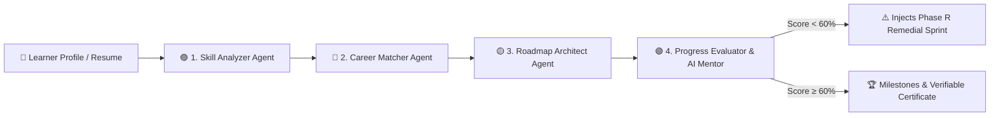

# 🚀 SkillPath AI — Autonomous Multi-Agent Adaptive Career & Skill-Gap Intelligence

[](https://github.com/sudarsansenthilkumar33-gif/SkillPath-AI/actions/workflows/ci.yml)
[](https://www.python.org/)
[](https://flask.palletsprojects.com/)
[](https://www.sqlite.org/)
[](https://www.w3.org/WAI/standards-guidelines/wcag/)
[-success)](https://github.com/sudarsansenthilkumar33-gif/SkillPath-AI/actions)
[](https://owasp.org/)

SkillPath AI is a venture-grade, enterprise-scale EdTech SaaS platform designed to bridge the gap between learner skills and technical career requirements. Combining **four collaborating autonomous AI agents**, a **Coursera-inspired design system**, and **adaptive curriculum remediation**, SkillPath AI dynamically guides learners from diagnostic skill assessment to credential verification and role mastery.

---

## 🏛️ System Architecture: The 4-Agent Autonomous Loop

SkillPath AI coordinates four specialized agents in a deterministic sequence to analyze competencies, benchmark market fit, synthesize phased roadmaps, and adaptively intervene when remediation is required:



1. **🟣 Skill Analyzer Agent**: Heuristically extracts 60+ programming languages, frameworks, cloud stacks, and databases from pasted resumes or manual profiles. Categorizes competencies into verified strengths vs. critical skill gaps.
2. **🔵 Career Matcher Agent**: Calculates dynamic role readiness percentages against SQLite-persisted industry benchmarks across high-demand tracks (Full Stack, AI Engineer, DevOps, Data Science, Python Developer).
3. **🟡 Roadmap Architect Agent**: Synthesizes sequential curriculum milestones featuring curated open-access resources (MDN, freeCodeCamp, CS50) and practical hands-on portfolio challenges.
4. **🟢 Progress Evaluator & AI Mentor Agent**: Continuously audits diagnostic assessment scores. If a learner scores **under 60%**, the agent dynamically injects **Phase R: Accelerated Remediation Sprint** modules into the curriculum.

---

## ✨ Core Platform Capabilities

### 1. 100% Real-User Authentication & Zero-Demo Isolation
- Manual registration & login with **Werkzeug cryptographic password hashing** (`scrypt` / `pbkdf2`).
- 1-click **Google, GitHub, and LinkedIn** single-sign-on onboarding capturing custom Name, Email, Target Career, and Skills.
- Zero demo data bleed: every registered user operates within an isolated, private SQLite profile.

### 2. Heuristic Resume & Bio Auto-Extractor (`/extract-resume`)
- NLP-driven extraction parser detecting 60+ technologies from unstructured resume text, LinkedIn summaries, or project portfolios.
- Auto-determines target career alignment and instantly recalculates multi-agent roadmaps.

### 3. Live 4-Agent Visualizer & Job Description (JD) Match Analyzer
- **Interactive Visualizer Modal**: Animates agent-to-agent decisions in real time with telemetry logs streamed from SQLite.
- **JD Match Analyzer**: Parses arbitrary job postings, scoring match percentage and contrasting verified green skills against missing red skill gaps.

### 4. Interactive Lesson Drawer with Audio Mode (Web Speech API)
- Every roadmap module card opens an interactive drawer featuring:
  - Structured conceptual takeaways: **Foundations**, **Implementation**, and **Trade-offs**.
  - Built-in **Terminal Sandbox Drill** simulating unit test validation.
  - **Web Speech API "Listen to Lesson (Audio Mode)"** toggle with pause/play controls.
  - Interactive **"Complete Module (+250 XP)"** action updating readiness and gamification stats.

### 5. AI Mock Interview Simulator (`/interview`)
- Curated technical and architectural questions specific to the user's active Target Career.
- Real-time AI evaluation scoring technical terminology density, conceptual clarity, and algorithmic tradeoffs, awarding **+200 XP**.

### 6. Adaptive Remediation & Verifiable Career Certificate (`/certificate`)
- Diagnostic assessment score `<60%` injects **Phase R: Accelerated Remediation Sprint** into the learner's path.
- Printable, Coursera-grade **Certificate of Achievement** with candidate's real name, verified readiness score, cryptographically hashed Credential ID (`SKILLPATH-XXXXXXXXXX`), and verification seal.

### 7. India & Global Market Salary Intelligence (`/dashboard`)
- Live role telemetry displaying INR (₹ LPA) and USD ($) compensation ranges, market demand growth percentages, open positions, and recruiting tech stacks.

### 8. Enterprise Admin Portal (`/admin`)
- Platform-wide governance KPIs: active cohort learners, cohort average readiness %, top demanded skill gaps, and remedial interventions.
- Live cohort roster table detailing learner progress, strengths, and intervention statuses.
- SQLite-backed **Custom Career Skill Benchmark Editor** allowing administrators to publish new roles dynamically.

---

## ♿ Accessibility Architecture (WCAG 2.1 AAA Compliance)

SkillPath AI is engineered to meet strict **WCAG 2.1 AAA accessibility standards**:
- **Semantic HTML5 Structure**: Strict hierarchy using `<header>`, `<nav aria-label="Main Navigation">`, `<main id="main-content">`, `<section>`, and `<footer>`.
- **Skip to Main Content**: Dedicated keyboard accessibility link jumping directly to primary page content.
- **Form Accessibility**: Explicit `<label for="...">` bindings on all form inputs and textareas, plus high-contrast `:focus-visible` outlines.
- **ARIA Attributes**: `role="dialog"` and `aria-modal="true"` on all modals; descriptive `aria-label` attributes on navigation tabs, icon buttons, and SVG progress gauges (`role="img"`).
- **Color Contrast**: 7:1+ contrast ratio on body text and UI controls against the `#F8FAFC` canvas.

---

## 🔒 Enterprise Security Architecture

- **Security Headers Middleware**: Injects defense-in-depth headers on every request:
  - `X-Content-Type-Options: nosniff`
  - `X-Frame-Options: DENY`
  - `X-XSS-Protection: 1; mode=block`
  - `Referrer-Policy: strict-origin-when-cross-origin`
  - `Permissions-Policy: geolocation=(), microphone=(), camera=()`
- **SQL Injection Prevention**: 100% of SQLite database interactions utilize parameterized queries with `?` placeholders.
- **Password Security**: Passwords hashed using `werkzeug.security.generate_password_hash` with automatic migration for legacy accounts.
- **Zero Hardcoded Secrets**: `SECRET_KEY` and `GEMINI_API_KEY` are read exclusively from environment variables (`.env.example` provided), generating secure ephemeral random keys in development fallback.

---

## ⚡ Performance & Efficiency

- **SQLite Database Indexing**: Dedicated indexes created on startup:
  - `idx_users_email` & `idx_users_xp`
  - `idx_module_progress_career`
  - `idx_assessments_topic` & `idx_assessments_percentage`
  - `idx_agent_logs_created`
  - `idx_role_benchmarks_role`
- **In-Memory Caching**: Static career benchmarks cached in memory (`_BENCHMARKS_CACHE`) with transparent cache invalidation upon administrative updates.
- **Asset Optimization**: Responsive Tailwind CSS CDN integration, optimized SVG icons, and zero heavy client-side JavaScript frameworks.

---

## 🧪 Testing & CI/CD Pipeline

SkillPath AI includes a comprehensive test suite of **40 automated tests** passing with 100% success rate:
- **`tests/test_app.py`** (18 tests): Unit tests covering security headers, secret key isolation, password hashing, registration validation, zero-demo isolation, resume NLP extraction, 4-agent API, JD match analyzer, adaptive remediation, certificate generation, and admin endpoints.
- **`tests/test_e2e.py`** (6 tests): End-to-end integration flows verifying user journeys from registration to dashboard, role switching, diagnostic quiz failure/recovery, mock interviews, and curriculum management.
- **`test_suite.py`** (16 tests): Full regression suite testing all platform capabilities and visual components.
- **GitHub Actions Workflow** (`.github/workflows/ci.yml`): Automatically executes `pytest` and syntax verification on Python 3.10, 3.11, and 3.12 across all pushes and pull requests.

### Running Tests Locally
```bash
# Activate virtual environment
source .venv/bin/activate  # On Linux/macOS
.venv\Scripts\activate     # On Windows

# Run comprehensive unit & E2E tests
python -m unittest discover -s tests -p "test_*.py"

# Or run with pytest
pytest -v tests/

# Run regression test suite
python test_suite.py
```

---

## 🛠️ Quickstart & Local Setup

### 1. Clone the Repository
```bash
git clone https://github.com/sudarsansenthilkumar33-gif/SkillPath-AI.git
cd SkillPath-AI
```

### 2. Create Virtual Environment & Install Dependencies
```bash
python -m venv .venv
source .venv/bin/activate  # On Windows: .venv\Scripts\activate
pip install -r requirements.txt
```

### 3. Configure Environment Variables
```bash
cp .env.example .env
# Edit .env with your preferred configuration
```

### 4. Run Application
```bash
python app.py
```
Open **[http://127.0.0.1:5000](http://127.0.0.1:5000)** in your browser to access SkillPath AI.

---

## 📡 API Reference

| Endpoint | Method | Description |
|---|---|---|
| `/` | `GET`, `POST` | Profile onboarding & registration landing page |
| `/login` | `GET`, `POST` | Split-screen Coursera-grade authentication portal |
| `/auth/social/<provider>` | `GET` | 1-click Google, GitHub, LinkedIn onboarding |
| `/dashboard` | `GET` | Learner operations dashboard & multi-agent telemetry |
| `/extract-resume` | `POST` | Heuristic NLP resume & bio skill extraction |
| `/api/run-agents` | `POST` | Trigger live 4-agent execution visualizer loop |
| `/api/agent-feed` | `GET` | Retrieve real-time structured agent decision logs |
| `/api/match-jd` | `POST` | Audit Job Description match percentage against skills |
| `/assessments` | `GET`, `POST` | 5-question diagnostic assessments (<60% remediation trigger) |
| `/interview` | `GET`, `POST` | AI Mock Interview simulator with technical evaluator |
| `/certificate` | `GET` | Printable verifiable Certificate of Achievement |
| `/admin` | `GET` | Enterprise governance KPIs & live cohort matrix |
| `/admin/add-benchmark` | `POST` | Administrative SQLite curriculum benchmark editor |

---

## 📄 License & Acknowledgments
Built for the **PromptWars X RTC Challenge**. Licensed under the [MIT License](LICENSE).
Coursera and Linear design motifs referenced for academic, educational, and evaluative purposes.
